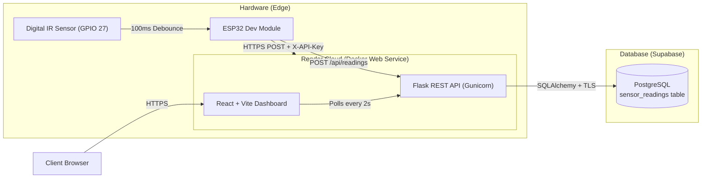

# IoT-Based Object Presence and Inventory Monitoring System

An end-to-end IoT monitoring system built for a college laboratory assignment. The system utilizes an **ESP32** microcontroller and a digital **Infrared (IR) proximity sensor** to monitor object presence at a single fixed location, storing timestamped telemetry in **Supabase PostgreSQL** and visualizing live state, freshness, and recent history on a modern **React + Vite** dashboard hosted on **Render**.

> **Scope Clarification:** This system monitors object presence at a **single fixed location**. Sampled events represent discrete presence observations and should not be interpreted as an automated continuous inventory counter.

---

## Architecture



---

## Technology Stack

- **Firmware:** ESP32, Arduino C++, PlatformIO, ArduinoJson 7, WiFiClientSecure.
- **Frontend:** React 18, Vite, TypeScript, Tailwind CSS, Lucide React, Recharts.
- **Backend:** Python 3.11, Flask 3, Gunicorn, SQLAlchemy 2, Psycopg 3.
- **Database:** Supabase PostgreSQL with Row Level Security (RLS) & composite index.
- **Container:** Multi-stage Docker build (Node 20 builder &rarr; Python 3.11 runtime).
- **Deployment:** Render Free Docker Web Service & GitHub.

---

## Hardware Wiring Schematic

| IR Sensor Pin | ESP32 Pin | Function | Notes |
|:---|:---|:---|:---|
| **VCC** | **3V3** | Power | Operates at 3.3V logic to protect ESP32 GPIOs |
| **GND** | **GND** | Ground | Common system ground |
| **OUT** | **GPIO 27** | Signal | Configured as `pinMode(27, INPUT)` |

### Sensor Polarity Verification
Most standard digital IR sensors (e.g., TCRT5000 / FC-51) output **LOW** when an obstacle reflects the infrared beam.
- The firmware sets `#define SENSOR_ACTIVE_LOW true`.
- If your sensor module outputs HIGH on detection, change this setting to `false` in [`firmware/include/config.h`](firmware/include/config.h).

---

## Directory Structure

```text
├── Dockerfile                  # Multi-stage production build (Node + Python)
├── compose.yaml                # Local container orchestration
├── render.yaml                 # Render Infrastructure-as-Code blueprint
├── .env.example                # Safe environment variable template
├── .gitignore                  # Strict secret and build artifact exclusion
├── backend/
│   ├── app.py                  # Flask API & React static file server
│   ├── database.py             # SQLAlchemy models & connection pool
│   ├── requirements.txt        # Backend dependencies
│   └── tests/
│       └── test_api.py         # Pytest test suite (11 test cases)
├── frontend/
│   ├── src/                    # React dashboard source code
│   ├── package.json            # Node dependencies
│   ├── tailwind.config.js      # Styling configuration
│   └── vite.config.ts          # Vite proxy and build settings
├── firmware/
│   ├── platformio.ini          # PlatformIO board & library configuration
│   ├── src/main.cpp            # Production edge firmware
│   └── include/
│       ├── config.example.h    # Configuration template
│       └── config.h            # Active local configuration (git-ignored)
├── supabase/
│   ├── config.toml             # Local Supabase configuration
│   └── migrations/             # Versioned SQL migrations (RLS, table, index)
├── scripts/
│   ├── setup_supabase.py       # Supabase provisioning & migration runner
│   ├── deploy_render.py        # Render deployment automation
│   ├── verify_deployment.py    # Deployed end-to-end verification script
│   └── orchestrator.py         # Master pipeline orchestrator
└── docs/
    ├── report-outline.md       # College assignment report outline
    ├── test-results.md         # Full verification results
    └── deployment.md           # Step-by-step cloud deployment instructions
```

---

## Local Development & Testing

### 1. Backend Setup
```powershell
# Create and activate virtual environment
python -m venv .venv
.\.venv\Scripts\activate

# Install backend dependencies
pip install -r backend/requirements.txt

# Run backend unit tests (11 tests)
python -m pytest backend/tests -v

# Start local backend server
python -m backend.app
```

### 2. Frontend Setup
```powershell
cd frontend
npm install
npm run build
npm run dev
```

### 3. Running with Docker Compose
```powershell
docker compose up --build
```
Access the application at `http://localhost:8000`.

---

## REST API Specification

### 1. Ingest Telemetry
- **Method:** `POST /api/readings`
- **Headers:** `Content-Type: application/json`, `X-API-Key: <DEVICE_API_KEY>`
- **Body:**
  ```json
  {
    "device_id": "esp32-01",
    "object_detected": true
  }
  ```
- **Response (201 Created):**
  ```json
  {
    "status": "success",
    "data": {
      "id": 1,
      "device_id": "esp32-01",
      "object_detected": true,
      "created_at": "2026-10-28T05:40:00.000000+00:00"
    }
  }
  ```

### 2. Query Latest Reading
- **Method:** `GET /api/latest?device_id=esp32-01`
- **Response (200 OK):**
  ```json
  {
    "status": "success",
    "device_id": "esp32-01",
    "data": {
      "id": 1,
      "device_id": "esp32-01",
      "object_detected": true,
      "created_at": "2026-10-28T05:40:00.000000+00:00"
    }
  }
  ```

### 3. Query Reading History
- **Method:** `GET /api/readings?device_id=esp32-01&limit=50`
- **Parameters:** `limit` between 1 and 200 (default: 50).
- **Response (200 OK):** Reverse-chronological array of readings.

### 4. Liveness Health Check
- **Method:** `GET /health`
- **Response (200 OK):** `{"status":"healthy","database":"connected","timestamp":"..."}`

---

## Cloud Deployment (Supabase & Render)

### 1. Push to GitHub
```powershell
git add .
git commit -m "feat: complete IoT object presence monitoring system"
gh repo create iot-object-monitor --public --source=. --remote=origin --push
```

### 2. Set Up Supabase & Apply Migrations
```powershell
$env:SUPABASE_ACCESS_TOKEN = "your_supabase_personal_token"
python scripts/setup_supabase.py
```

### 3. Deploy to Render
```powershell
$env:RENDER_API_KEY = "your_render_api_key"
$env:DATABASE_URL = "your_supabase_connection_string"
python scripts/deploy_render.py
```

### 4. Verify Live Deployment
```powershell
$env:DEPLOYED_URL = "https://your-service.onrender.com"
python scripts/verify_deployment.py
```

---

## Firmware Uploading to ESP32

Your ESP32 is detected on port **`COM22`**.

To compile and flash the firmware:
```powershell
& "$env:USERPROFILE\.platformio\penv\Scripts\pio.exe" run -d firmware -t upload --upload-port COM22
```

To view the live Serial Monitor:
```powershell
& "$env:USERPROFILE\.platformio\penv\Scripts\pio.exe" device monitor -d firmware --port COM22 --baud 115200
```

---

## Live Demonstration Procedure

1. **Pre-Demo Warmup:** Open the Render URL in a browser 1 minute prior to your demo to wake the container from sleep.
2. **Observe Baseline:** Dashboard displays `NO OBJECT` with freshness status `LIVE`.
3. **Trigger Event:** Place an object (e.g., small box or card) in front of the IR sensor on GPIO 27.
4. **Inspect Reaction:**
   - The ESP32 immediately registers the state change (<100ms debounce) and transmits a POST request.
   - The dashboard updates within 2 seconds to `OBJECT PRESENT` with an emerald badge and chart step.
5. **Remove Object:** Remove the object. The dashboard reverts to `NO OBJECT`.
6. **Stale Alert Test:** Unplug the ESP32. After 30 seconds, observe the amber `STALE` banner alerting that no telemetry has been received.

---

## Security Configuration

- **Zero Hardcoded Secrets:** All secrets (`.env`, `config.h`, `deployment-secrets.json`) are ignored by Git.
- **Timing-Attack Resistance:** The backend uses `hmac.compare_digest` to validate `X-API-Key`.
- **Database Isolation:** Supabase Row Level Security (RLS) is enabled and anonymous PostgREST access is revoked.
- **HTTPS Enforcement:** Production traffic is encrypted using TLS.
